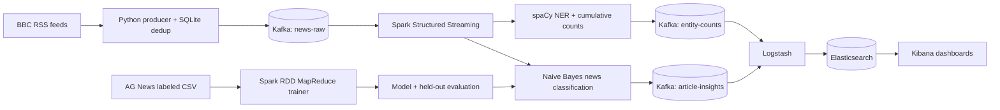
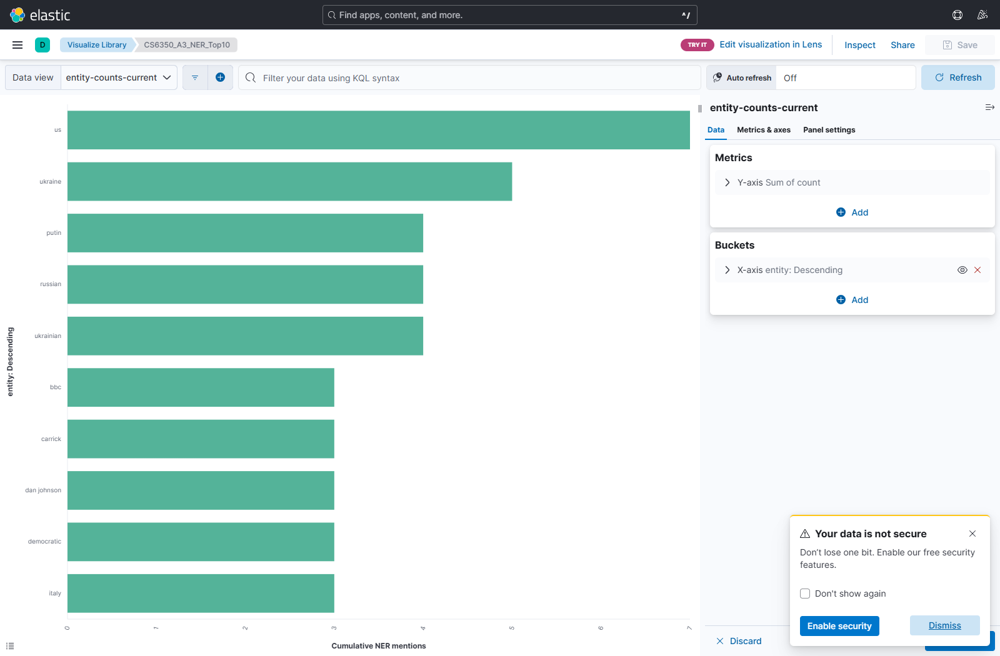
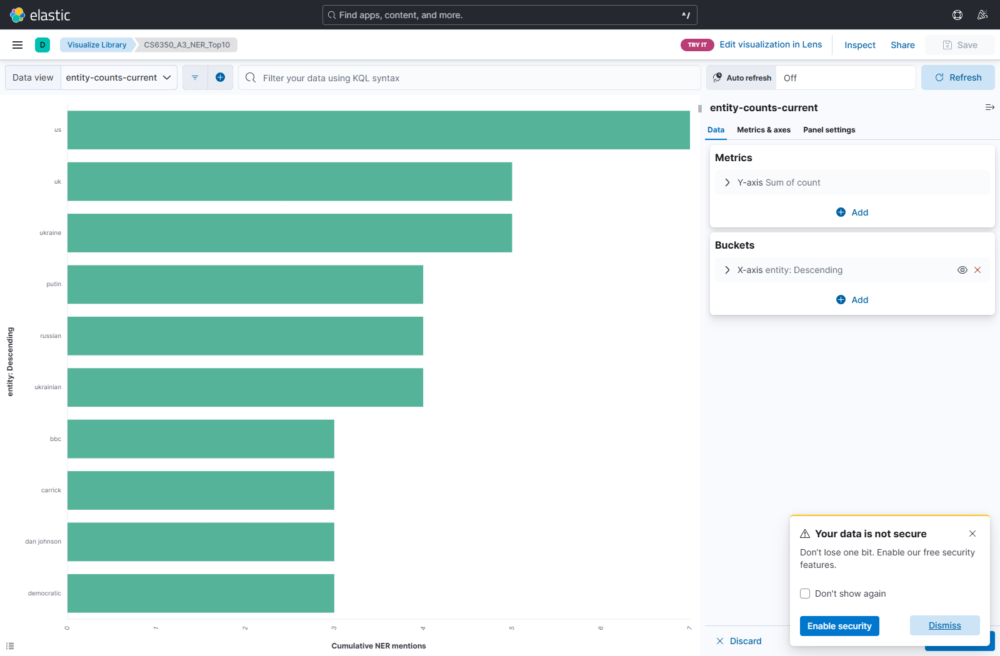

# Real-Time News Intelligence & Analytics Platform

**Batch NLP + real-time streaming + explainable text classification in one Spark project.**

A reproducible news analytics pipeline that ingests BBC RSS headlines, classifies each article into **World / Sports / Business / Sci-Tech**, extracts named entities, maintains their cumulative frequency, and indexes the results for exploration in Kibana. The classifier is a **from-scratch Multinomial Naive Bayes** implementation using Spark RDD MapReduce, trained and evaluated on AG News.

**Stack:** Python 3.11 · Apache Spark 3.5.5 · Spark Structured Streaming · Kafka · spaCy · NLTK · Elasticsearch 8.17 · Logstash · Kibana · Docker Compose

## Architecture



The pipeline has **two different evaluation targets**: labeled AG News accuracy/F1 for classification, and Spark/Kafka/Elasticsearch processing metrics for the live pipeline. The live BBC feed is **unlabeled**, so its classification accuracy cannot be inferred from the AG News test results.

## Features

- BBC RSS polling with URL/GUID-based article deduplication persisted in SQLite.
- Kafka-based ingestion with durable topics and explicit Spark checkpoints.
- spaCy NER for people, organizations, places, and other named entities.
- Cumulative entity counts using Structured Streaming `groupBy(...).count()`.
- Four-category news classification using a Spark RDD MapReduce Multinomial Naive Bayes model with Laplace smoothing and log probabilities.
- Elasticsearch documents keyed by `article_id` or `entity_id`, allowing upserts instead of duplicated dashboard records.
- Kibana data views for both classified articles and current top named entities.
- A separate optional NLTK + Spark MapReduce batch NER benchmark on public-domain *War and Peace* text.
- Local unit tests, model evaluation JSON, stream throughput summaries, and indexed-document audits.

## Recorded dashboard evidence

The images below are **unmodified screenshots from an earlier project run on November 12, 2026**, not screenshots produced by the new integrated classification code. They show **NER entity counts**, not model accuracy.

| About 15 minutes | About 60 minutes |
|:--:|:--:|
|  |  |

The original **[30-minute](screenshots/kibana_top10_30min.png)** and **[45-minute](screenshots/kibana_top10_45min.png)** screenshots are included too. These two images are byte-identical; their associated top-10 CSV exports match. They have not been altered to imply the counts changed. See [Screenshot provenance](docs/screenshots.md).

The archived audit reports **69 input articles, 208 entity mentions, 141 entity/type records, and 695 Kafka entity-update messages**. This is **historical saved evidence** from the prior NER-only run, not a new benchmark or the classifier's accuracy. See `results/archive_2026-11-12_pipeline_verification.json`.

### Previously measured AG News classifier baseline

The earlier standalone Spark MapReduce assignment recorded **90.29% accuracy (21,650 correct out of 23,979 test articles)** and **0.9025 macro-F1**, with a vocabulary of 57,219 terms. These figures were checked against the original confusion-matrix totals and are stored with provenance in `results/archived_ag_news_baseline.json`. **This is a historical AG News test result, not a measured score for the new live BBC integration.** Run the trainer below to generate current metrics under your local setup; the split can vary with Spark partition count.

## Project layout

```text
real-time-news-intelligence/
├── src/
│   ├── bootstrap.py                 # Create topics and search indices
│   ├── news_producer.py             # BBC RSS -> Kafka, persistent dedup
│   ├── common.py                    # Text cleaning and stable IDs
│   ├── train_classifier.py          # Spark MapReduce Naive Bayes training/evaluation
│   ├── news_classifier.py           # Tokenizer, prediction and model I/O
│   ├── structured_news_stream.py    # Spark streaming: NER + classification
│   ├── batch_named_entities.py      # Optional Gutenberg/NLTK MapReduce
│   └── init_indices.py             # Elasticsearch mapping/reset utility
├── scripts/
│   ├── setup_kibana.py              # Create data views and NER bar chart
│   ├── classify_text.py             # Classify a new headline locally
│   ├── report_stream_metrics.py     # Spark throughput and batch durations
│   └── audit_live_index.py         # Count/lag of indexed records
├── config/logstash/pipeline/        # Kafka -> Elasticsearch indexing
├── screenshots/                     # Original Kibana screenshots
├── results/                         # Archived NER/AG News evidence and top-10 CSVs
├── docs/                            # Architecture, metrics, evidence
├── metrics/                         # Generated metrics; empty until run
├── artifacts/                       # Generated model; not committed
├── run/                             # Checkpoints/state; not committed
├── tests/                           # Unit tests
├── docker-compose.yml
├── Dockerfile
└── requirements.txt
```

## Getting started

**Prerequisites:** Docker Desktop with Docker Compose, internet access (Docker images, Spark Kafka connector, AG News, BBC RSS), and preferably **12 GB or more RAM available to Docker**. Commands work from the project root in macOS Terminal, Linux, or PowerShell. Free ports **9092, 9200, and 5601**. You do not need to install Spark, Java, Kafka, Elasticsearch, or spaCy locally.

### 1. Start the services

```bash
docker compose up -d --build --wait --wait-timeout 300
```

This builds the Python/Spark runtime and starts Kafka, Elasticsearch, Logstash and Kibana. Then create three Kafka topics and both Elasticsearch indices:

```bash
docker compose exec -T runtime python src/bootstrap.py
```

### 2. Train and evaluate the classifier (one-time)

```bash
docker compose exec -T runtime spark-submit --master 'local[2]' --driver-memory 3g src/train_classifier.py
```

The trainer downloads the **120,000-row AG News training CSV**, verifies its pinned checksum, uses a **seed-42 80/20 random split**, and learns class priors and token likelihoods with RDD `map` / `flatMap` / `reduceByKey`. It writes:

- `artifacts/naive_bayes_model.json.gz` — compressed model, local-only, not committed.
- `metrics/classifier_metrics.json` — **actual** measured accuracy, macro/weighted F1, per-class precision/recall/F1, confusion matrix, vocabulary size, and training/scoring times.

The code does not ship with invented accuracy numbers. Inspect the generated metrics before adding them to a resume or committing them to GitHub. The split uses the **AG News training CSV**, not its separate official test set.

### 3. Start the live streaming job (Terminal A)

```bash
docker compose exec -T runtime spark-submit --master 'local[2]' --driver-memory 2g --conf spark.sql.shuffle.partitions=8 --packages org.apache.spark:spark-sql-kafka-0-10_2.12:3.5.5 src/structured_news_stream.py --bootstrap kafka:29092 --trigger '30 seconds'
```

This reads `news-raw` and publishes **both** `entity-counts` and `article-insights`. Leave it running. The first execution downloads the Spark Kafka connector from Maven. Its status is stored in `run/stream_progress.jsonl` and separate Spark checkpoints.

### 4. Start BBC ingestion (Terminal B)

```bash
docker compose exec -T runtime python src/news_producer.py --bootstrap kafka:29092 --state-db /workspace/run/news-seen.sqlite3 --start-marker /workspace/run/start_marker.json --poll-seconds 60
```

Each new RSS item is sent to `news-raw`. The producer remembers previously published articles across restarts. **This is an RSS headlines + summaries pipeline, not full-article scraping.** A fresh run need not match the older screenshot counts.

### 5. Explore results in Kibana

Open **http://localhost:5601**. Once Kibana is ready, set up the data views and named-entity bar visualization:

```bash
docker compose exec -T runtime python scripts/setup_kibana.py --kibana-url http://kibana:5601
```

Open **Visualize Library** → **News Intelligence | Top Named Entities**. The metric is **Sum(`count`)** and the breakdown is **Top 10 `entity`**, not a raw Elasticsearch document count. Use the `news-article-insights` data view in Kibana's **Discover** tab to inspect categories, headlines and timestamps. You can add a Lens bar/pie chart using **Count of records by Top values of `category`**.

If the legacy saved-visualization API is unavailable in your Kibana build, create the two data views and the bar chart manually using the fields above. All ingestion and evaluation are independent of Kibana visualization setup.

## Accuracy and performance metrics

After a real run, these commands generate reproducible, resume-appropriate evidence:

```bash
# Classifier accuracy / F1 (generated during step 2)
docker compose exec -T runtime cat metrics/classifier_metrics.json

# Spark processed rows/second and p95 microbatch execution time
docker compose exec -T runtime python scripts/report_stream_metrics.py --query news_classification

# Indexed article totals, category counts, NER totals, p50/p95 ingest-to-processing lag
docker compose exec -T runtime python scripts/audit_live_index.py --es-url http://elasticsearch:9200
```

Outputs: `metrics/classifier_metrics.json`, `metrics/stream_performance.json` and `metrics/index_audit.json`. Each metric is labeled by dataset and measurement method in [Evaluation and resume guidance](docs/evaluation.md). **Accuracy only measures classification on labeled test data**; throughput and lag measure the live stream. At low real RSS volume, throughput does not represent maximum Spark capacity.

### Optional: classify any headline

```bash
docker compose exec -T runtime python scripts/classify_text.py "Stocks rally as the company reports higher quarterly revenue"
```

### Optional: batch NER/WordCount (separate benchmark)

```bash
docker compose exec -T runtime spark-submit --master 'local[2]' --driver-memory 2g src/batch_named_entities.py --top 25
```

Downloads *War and Peace* from Project Gutenberg using `wget`, extracts NLTK named entities and counts them with Spark RDD MapReduce. This is intentionally **not** part of the BBC dashboard, and may take longer on a large text.

### Run unit tests / stop services

```bash
docker compose exec -T runtime pytest -q tests
docker compose down
```

To start a genuinely independent benchmark, stop the stack and use `docker compose down -v` **only if you intend to delete Kafka and Elasticsearch data**; also remove `run/` state and checkpoints before restarting. Never delete checkpoints while streaming is running. For normal restarts, preserve volumes and `run/` state.

## Design notes and limitations

- The producer acknowledges Kafka before committing SQLite dedup state. Failure/restart can replay a message; the pipeline should be treated as **at-least-once**, not exactly-once end-to-end.
- The NER output is a **cumulative snapshot**, not one record per entity mention. Its state grows over time without an event-time expiration policy. Intended for bounded/portfolio runs.
- The classified-article stream writes append events with deterministic article IDs; Logstash upserts by article ID. It does **not** guarantee exactly-once processing under all failures.
- **AG News and BBC RSS are different data distributions.** AG News held-out accuracy is not a measured BBC classification accuracy; a manually labeled BBC sample would be needed to assess that.
- This is a **single-machine Docker demo**, not a production-scale cluster or a throughput stress test. RSS polling frequency and the available BBC feed limit ingestion volume.
- Keep Kafka/Elasticsearch ports bound to localhost; this demonstration disables Elasticsearch security and must not be exposed publicly.

More details: [Architecture](docs/architecture.md) · [Evaluation and resume evidence](docs/evaluation.md) · [Screenshots and provenance](docs/screenshots.md).

## Acknowledgments and attribution

Adapted and extended from CS 6350 coursework implementations: Spark MapReduce NLTK NER, AG News Multinomial Naive Bayes, and a collaborative BBC RSS/Kafka/Spark/spaCy/Kibana streaming exercise. The real-time classifier integration, model export, metric reporting, and repository packaging extend those foundations. Public sources: [BBC RSS](https://feeds.bbci.co.uk/news/rss.xml), [AG News CSV](https://github.com/mhjabreel/CharCnn_Keras/tree/master/data/ag_news_csv), [Project Gutenberg #2600](https://www.gutenberg.org/ebooks/2600), [Apache Spark](https://spark.apache.org/), and [Elastic](https://www.elastic.co/guide/).

**Before making this repository public:** check the course's solution-publication policy and obtain any coauthor permission required for collaborative code. No dataset, secret, report, student ID, or original assignment submission cover sheet is committed here.

## Publish to GitHub

Create an **empty** GitHub repository named `real-time-news-intelligence` (without auto-generating a README), then from this folder run:

```bash
git init
git add .
git commit -m "Build real-time news intelligence platform"
git branch -M main
git remote add origin https://github.com/YOUR_USERNAME/real-time-news-intelligence.git
git push -u origin main
```

Your four archived screenshots and source code are tracked. Runtime checkpoints, the trained model and downloaded datasets are intentionally excluded; after a successful benchmark you can commit only the reviewed `metrics/*.json` files. GitHub Actions runs syntax checks and eight unit tests on pushes and pull requests (it does not run the full Docker pipeline).
